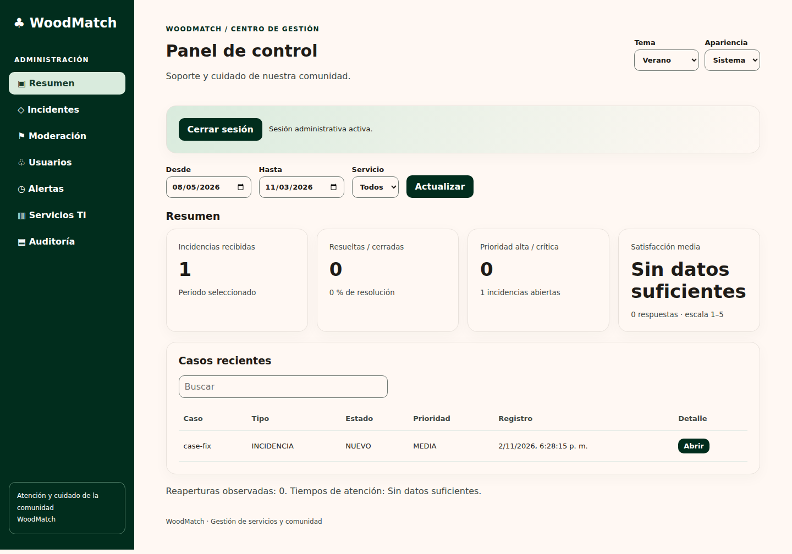
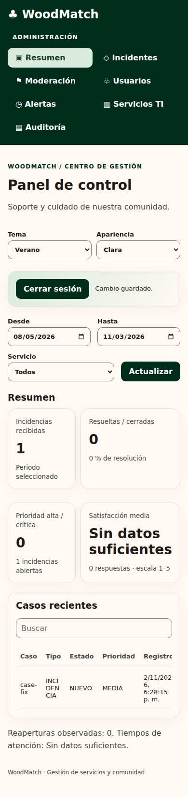

# Informe de ejecución WoodMatch — 3 de noviembre de 2026

Base: main `e42bc112d4eaa1e198b51577319d900fed5a100f`. No se modificó código Android ni reglas Firestore. No se fusionó ni desplegó a producción.

## Pull Requests y alcance

- Fase 1: [PR #14](https://github.com/HOLA-GG/WoodMatch/pull/14): control documental, evidencia y contrato KPI.
- Fase 2: [PR #15](https://github.com/HOLA-GG/WoodMatch/pull/15), rama `feat/private-ti-dashboard-20261103`, sobre fase 1: frontend, backend lector dedicado, pruebas, CI y secuencias. Integrar primero fase 1 y después fase 2 tras revisión.

## Checklist

| Entregable | Estado | Resultado verificable |
|---|---|---|
| Inventario, trazabilidad ST-01 a ST-15, versiones y acciones correctivas | Completado documental | [Control de calidad](wiki/Control-de-calidad-y-evidencias.md) |
| Definición de KPI, metas y FAQ de operación | Completado documental | [Manual](wiki/Dashboard-Web.md); objetivos académicos del catálogo |
| Ciclo soporte completo | Completado en fixture automatizado | support.test.mjs; prueba física pendiente |
| Render de ocho Mermaid existentes en GitHub | Completado | Desarrollo técnico (5), catálogo (1), roles (1), soporte (1); iframe con salida de diagrama y SVG. No se detectaron errores de sintaxis |
| Nuevas secuencias | Completado: cuatro diagramas renderizados en GitHub sin error de sintaxis | [Secuencias](wiki/Secuencias-de-servicio.md) |
| Capturas existentes | Inventario técnico completado | 12 archivos y dimensiones; privacidad/legibilidad humana pendientes |
| Capturas de teléfono faltantes | Bloqueado por evidencia | Guía precisa de captura en control de calidad |
| Auditorías cruzadas finales y anexos | Bloqueado por evidencia | No disponibles entre los adjuntos; no inventados ni archivados como finales |
| Dashboard demo responsive | Completado y probado localmente | Capturas abajo; navegación, búsqueda y detalle |
| Backend real protegido | Implementado, comprobado con fixtures | Firma JWT, revocación, allowlist, CORS y cuota; sin despliegue |
| Login real / datos privados reales | Bloqueado por configuración | Acceso a consola confirmado; proyecto woodmatch-piloto solo tiene app Android registrada. Falta registrar app web y confirmar cuentas lectoras/secretos del endpoint dedicado |
| Hosting y producción | Pendiente, sin ejecutar | Entorno de prueba y destino deben verificarse; producción requiere aprobación |
| CI remoto web | Aprobado sobre código 956d709 | [Dashboard quality](https://github.com/HOLA-GG/WoodMatch/actions/runs/41733984739): instalación, enlaces, pruebas, build, navegador y Deno aprobados. Pipeline Android separado aún en ejecución al registrar este resultado |
| Wiki nativa GitHub | Pendiente deliberado | docs/wiki sigue siendo fuente canónica; no sincronización implícita |

## Arquitectura y protección

Navegador → Firebase Auth → ID token → función dedicada Supabase → validación firma RS256, issuer/audience/caducidad, cuenta habilitada y revocación → allowlist secreta de lectores → cuota transaccional → Firestore → proyección minimizada y agregados.

Solo lectura de casos. Sin permisos de moderación desde web. Ningún UID de operador, correo personal, service account ni secreto se incorpora al frontend. La allowlist no copia ni amplía la autorización actual del operador Android. La función actual de producción no fue alterada. Registros excluyen identidad, token, asunto y cuerpo del caso.

Limitaciones: consultas completas con límite de 10 000 casos, limpieza de cuotas pendiente de preparar antes de uso continuado, falta de serviceId en casos actuales, historial limitado a 50 eventos y ausencia de evento inequívoco de primera respuesta. Tiempos y disponibilidad muestran Sin datos suficientes. El panel Android aproxima primera atención por la primera acción de otro actor; no es equivalente a una respuesta escrita. Reaperturas representan mínimo observado. Cohorte por creación con estado actual, no reconstrucción histórica.

## Validaciones locales

| Comando / revisión | Resultado |
|---|---|
| `npm --prefix backend-tests test` | 32 aprobadas; 0 fallidas |
| `deno test --allow-env backend-tests/edge.test.ts` | 8 aprobadas; 0 fallidas (backend actual, servicios externos simulados) |
| `deno test --allow-env backend-tests/dashboard-edge.test.ts` | 4 aprobadas; 0 fallidas (JWT firmado de prueba, lookup/datos simulados) |
| `deno check` de index/maintenance existentes y nuevo index dashboard | Aprobado |
| `npm --prefix dashboard run check` | Sintaxis JS y 4 tests KPI/política aprobados, incluidos en las 32 anteriores |
| `npm --prefix dashboard run build` | Aprobado con Vite 8.3.5 |
| `npm --prefix dashboard audit --audit-level=high` | 0 vulnerabilidades tras actualización y override gRPC |
| `npm --prefix dashboard run test:web` | Escritorio 1440×1000, móvil 390×844, sin desbordamiento global, navegación, búsqueda, diálogo, aislamiento demo/real y sin excepciones JS |
| `python scripts/check-wiki-links.py` | 124 enlaces/imágenes locales comprobados; 0 ausentes al cierre |
| `git diff --check` | Sin errores |
| Supabase security advisors, consulta de solo lectura | Sin lints devueltos; no equivale a auditoría integral de Firebase o seguridad de aplicación |
| Android, reglas en emulador, login Firebase real | No ejecutados localmente; no declarar aprobados |

Deno local utilizó el paquete jose 5.9.6 instalado por npm y `--node-modules-dir=manual` porque la resolución npm directa de Deno quedó esperando. No se incorporan dependencias temporales al repositorio. El workflow remoto resuelve Deno normalmente.

Las capturas siguientes contienen únicamente fixtures generados; no representan cuentas o incidentes de producción.

## Pendientes necesarios para conexión real

1. Acceso autenticado confirmado en Firebase Console: WoodMatch Piloto, plan Spark. Solo app Android registrada. No se cambió configuración ni se generaron credenciales. No enviar contraseñas por chat.
2. Registrar/verificar configuración pública web, dominios autorizados y proveedor actual sin alterar producción.
3. Confirmar las identidades lectoras exactas mediante canal privado y secretos de servidor; no inferir UID del equipo.
4. Preparar entorno de prueba y limpieza de cuotas, verificar IAM y origen CORS. Aprobar despliegue del entorno dedicado; ejecutar cuenta permitida, ajena, revocada y sesión caducada con backend real.
5. Adjuntar evidencias del teléfono y anexos finales anonimizados; completar aceptación conjunta.
6. Revisar checks remotos, resolver fallos si aparecen y solicitar autorización expresa antes de cualquier despliegue productivo.

## Archivos

El manifiesto [DASHBOARD_CHANGED_FILES.txt](DASHBOARD_CHANGED_FILES.txt) enumera adiciones y modificaciones de ambas fases respecto a main. No se eliminan archivos. Se conserva documentación histórica y se evita presentar datos simulados como métricas reales.
