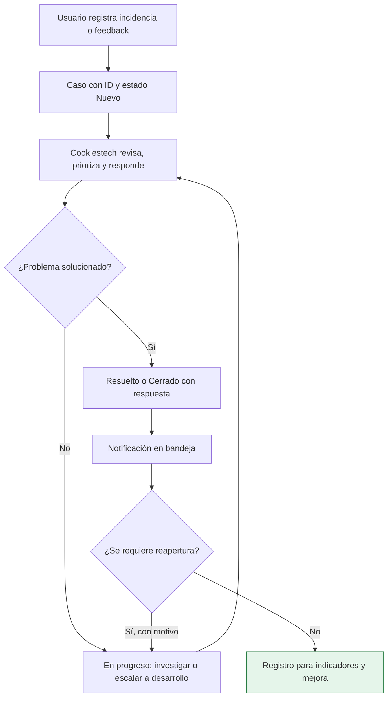

# Administración, feedback y moderación — WoodMatch 2.3

**Estado:** documentación del piloto revisada el 30 de octubre de 2026. Ver [Manual de usuario y gestión de servicios TI](Manual-de-usuario.md), secciones 12–14, y [Catálogo de servicios TI](Catalogo-de-servicios-TI.md).

## 1. Distinguir los accesos

| Perfil | Estado y alcance |
|---|---|
| **Soporte Cookiestech** | Identidad restringida verificada en backend mediante UID y correo; permite bandeja de soporte, respuestas, prioridad y moderación. No equivale a administrador global. |
| **Administrador general** | Se mantiene como modelo/ruta administrativa de desarrollo; su operación completa exige backend autorizado, claims firmados y reglas verificadas. No afirmar que basta cambiar `role` en Firestore. |
| **Usuarios comunitarios** | Pueden registrar incidencias, feedback, opiniones y satisfacción; reportar publicaciones mediante el flujo apropiado. No acceden a los casos de otras cuentas. |

No publicar contraseñas ni identificadores secretos del operador, ni atribuirle capacidades de bloqueo o edición general de cuentas no existentes en la pantalla actual.

## Resumen visual del proceso de soporte

## 2. Registro y seguimiento de casos (actualmente implementado en código)

1. El usuario abre **Ayuda y participación** y registra **INCIDENCIA**, **FEEDBACK**, **OPINION** o **SATISFACCION** con asunto y detalle. Un reporte asociado a una publicación puede usar **MODERACION**.
2. El backend crea un caso con ID, fecha, autor, prioridad, estado **NUEVO** e historial. La cuota limita el número de casos por persona y día.
3. Cookiestech consulta **Centro de soporte → Atender casos**, busca y filtra por estado o prioridad.
4. Puede seleccionar **BAJA, MEDIA, ALTA o CRITICA** y estado **NUEVO, EN_REVISION, EN_PROGRESO, RESUELTO o CERRADO**, y guardar una respuesta.
5. **RESUELTO** y **CERRADO** requieren una respuesta en el servidor. El usuario puede **Reabrir caso** con motivo desde un caso resuelto o cerrado.
6. Se genera una notificación para el usuario ante respuesta de soporte. El historial registra las transiciones; no se debe asumir que la notificación emergente del teléfono se recibió si no se probó.

**Alcance funcional:** no existe todavía un módulo separado de gestión de problemas con causa raíz, una consola de asignación multioperador ni un SLA contractual. Pueden documentarse como propuestas ITIL 4 y evaluarse en futuras versiones.

## 3. Moderación (actualmente implementada en código)

- Los casos de **MODERACION** se relacionan con una publicación reportada.
- El operador revisa texto/fotografía y registra motivo antes de **Ocultar** o **Restaurar**.
- El servidor comprueba estados permitidos: la ocultación aplica a publicaciones en estados admitidos como **HALLAZGO** o **DISPONIBLE**, y la restauración a publicaciones **MODERADO**.
- Los materiales reservados/recolectados no pueden tratarse como publicaciones disponibles sin comprobar el ciclo de entrega.
- La acción registra operador, motivo, fecha y evento. No implica borrar toda la cuenta ni contenido de otras operaciones.

## 4. Diseño seguro para administración general (pendiente de validar)

Estas condiciones son **requisitos de diseño**, no capacidades que se declaren ya desplegadas:

- Asignar/revocar un `custom claim` firmado por Firebase Admin desde una operación de backend protegida y auditada.
- Hacer que Firestore verifique `request.auth.token.admin == true` antes de permitir operaciones administrativas.
- Impedir autoasignación de privilegios desde Android o campos editables.
- Renovar el token tras asignación o revocación de claims.
- Aprovisionar la primera identidad administrativa por un procedimiento privado, no por un endpoint público.
- Probar reglas, acceso denegado y trazabilidad antes de aprobar despliegue.

## 5. Evidencias y controles

Revisar [EV-08 Ayuda y participación, EV-09 Centro de soporte y EV-10 Moderación](Evidencias-de-servicios.md). Las capturas demuestran la interfaz; para sustentar operación son necesarios casos de prueba con creación, transición, respuesta, cierre, reapertura y moderación justificada, sin datos reales de terceros.

**Responsables:** Juan Sebastian Fune Sanchez, mantenimiento y corrección técnica; Yeison David Diaz Navarrete, pruebas funcionales y documentación. La cuenta Cookiestech es una identidad operativa de la aplicación, no un tercer integrante del proyecto.
