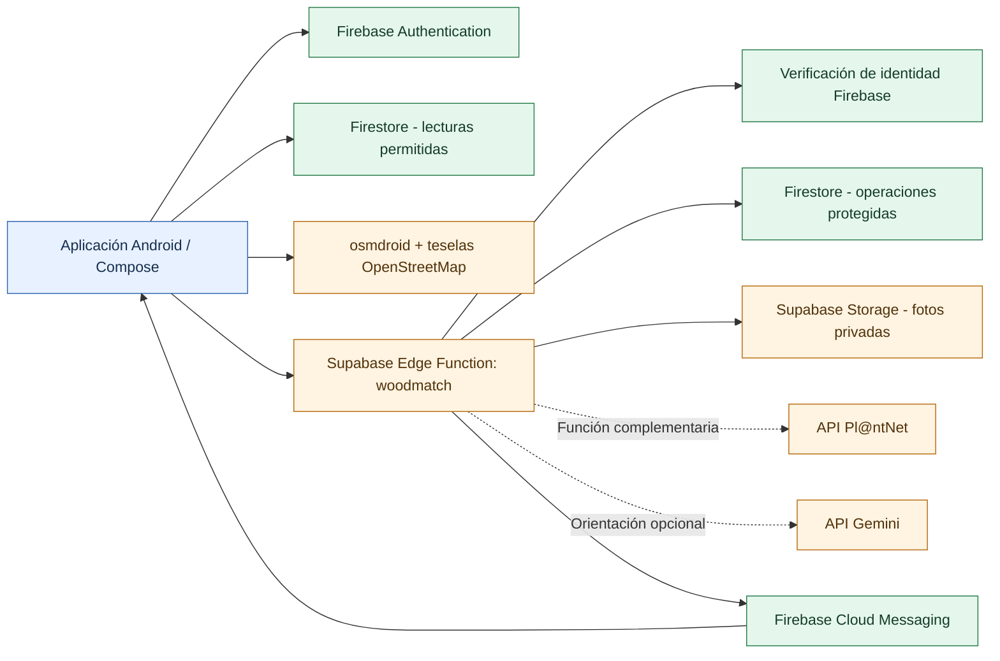
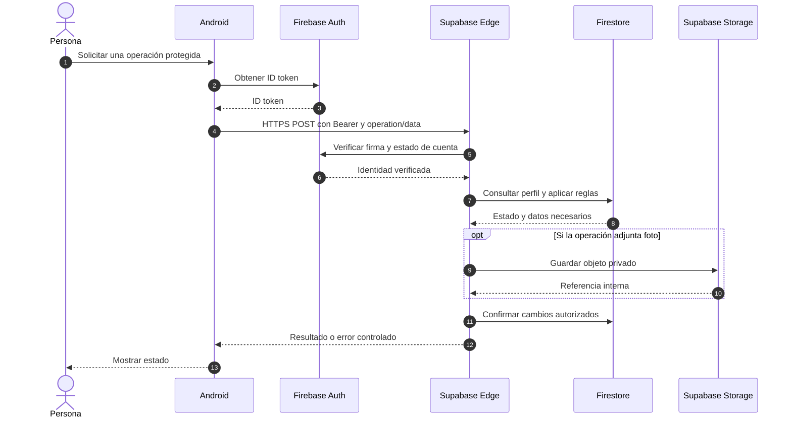
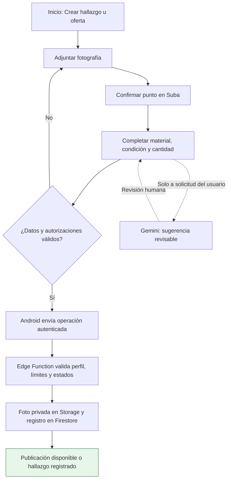
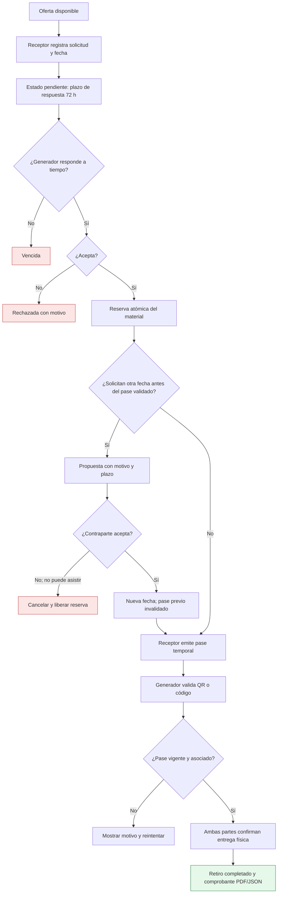
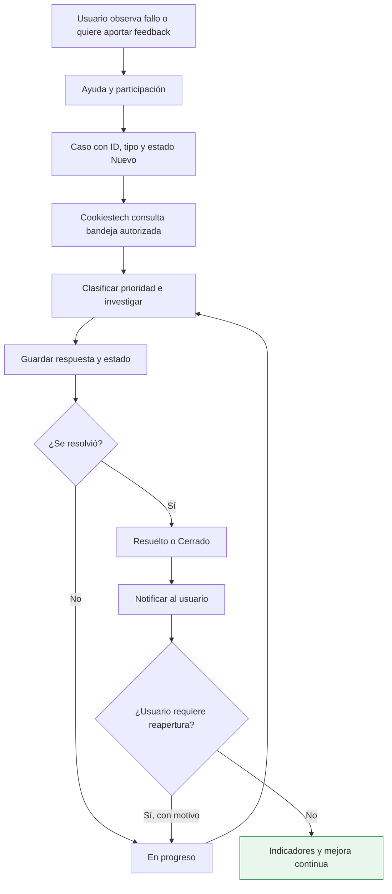

# Desarrollo técnico de WoodMatch

**Proyecto:** WoodMatch 2.3 · Piloto comunitario Android — Suba, Bogotá  
**Documento:** Desarrollo-Tecnico-Woodmacth.md (nombre solicitado)  
**Actualización:** 30 de octubre de 2026  
**Responsable técnico:** Juan Sebastian Fune Sanchez · **Pruebas y documentación:** Yeison David Diaz Navarrete

> **Lectura importante.** Este documento explica la arquitectura y los flujos presentes en el repositorio `HOLA-GG/WoodMatch` a la fecha de revisión. Los fragmentos son extractos breves o *pseudocódigo ilustrativo*, señalados en cada caso, y nunca contienen contraseñas, tokens válidos ni valores de claves. Que una ruta exista en el código **no certifica** despliegue en producción ni resultados de CI. Los archivos históricos de `docs/` documentan versiones anteriores y no deben confundirse con el estado actual.

## 1. Objetivo y estructura del repositorio

WoodMatch conecta personas que **ofrecen** y **solicitan** madera o residuos leñosos. El flujo principal es publicar → explorar → solicitar → reservar → validar pase → confirmar ambas partes → generar comprobante. Dispone, además, de mapa OSM, notificaciones, soporte Cookiestech y funciones **complementarias** de escáner y álbum botánico, con asistencia de IA opcional.

| Ruta en el repositorio | Papel |
|---|---|
| `app/src/main/kotlin/com/example/kotlinapp/` | Aplicación Android actual, interfaz Jetpack Compose y lógica cliente |
| `app/src/main/kotlin/com/example/kotlinapp/ui/screens/` | Pantallas: autenticación, mapa, catálogo, actividad, álbum, soporte |
| `app/src/main/kotlin/com/example/kotlinapp/ui/pilot/` | Asistente de publicación y componentes comunitarios |
| `app/src/main/kotlin/com/example/kotlinapp/data/repository/` | Repositorios de usuarios, materiales, álbum y preferencias |
| `app/src/main/kotlin/com/example/kotlinapp/data/network/` | Cliente de Edge Function, Pl@ntNet, Gemini y telemetría |
| `app/src/main/kotlin/com/example/kotlinapp/ui/components/` | Controles compartidos, pases QR, comprobantes, formularios |
| `supabase/functions/woodmatch/index.ts` | Endpoint Deno de la Edge Function `woodmatch`; autentica y despacha operaciones |
| `supabase/functions/woodmatch/domain.mjs` | Reglas de dominio, idempotencia y transacciones de materiales |
| `supabase/functions/woodmatch/lifecycle.mjs` | Plazos, vencimientos, reprogramaciones y avisos |
| `supabase/functions/woodmatch/support.mjs` | Casos de soporte y moderación |
| `supabase/functions/woodmatch/firestore.mjs` | Acceso servidor a Firestore vía API |
| `supabase/functions/woodmatch/notifications.mjs` | Registro de dispositivos y entrega de avisos |
| `.github/workflows/pilot.yml` | Flujo CI para pruebas, validaciones, lint y compilación |
| `Kotlin_App/` | Prototipo histórico; **no** es la aplicación Android raíz vigente |

Los modelos de datos y las pantallas evolucionan; ante cualquier diferencia entre documentación y código, validar la versión del APK instalada y las operaciones del backend antes de dar un flujo por aceptado.

## 2. Arquitectura general y relación Firebase–Supabase

WoodMatch es una aplicación Android con **Firebase Authentication** para identidad y **Firestore** como base de datos operativa. Una **Supabase Edge Function** actúa como puerta de entrada para operaciones protegidas, utiliza su propia lógica de negocio y accede a Firestore mediante credenciales de servidor. **Supabase Storage** almacena fotografías privadas. El mapa se dibuja nativamente con osmdroid usando teselas de **OpenStreetMap**. Pl@ntNet y Gemini son servicios externos opcionales consumidos desde el backend.



**Lectura del diagrama:** la aplicación conoce la URL pública de la función, pero **no** guarda en el APK credenciales de servicio de Firebase, clave privilegiada de Supabase ni claves privadas de Gemini/Pl@ntNet. El nombre “Supabase” identifica el alojamiento del endpoint y las fotografías, **no** una sustitución de Firebase Authentication o Firestore.

### 2.1 Por qué usar Firebase y Supabase a la vez

| Elemento | ¿Qué administra? | ¿Qué NO hace? |
|---|---|---|
| Firebase Authentication | Registro, sesión y emisión de ID token | No autoriza por sí solo a publicar material ajeno |
| Firestore | Perfiles, publicaciones, solicitudes, eventos, casos, notificaciones | No reemplaza validación de reglas de negocio |
| Supabase Edge Functions | Recibe peticiones HTTPS, verifica identidad y aplica reglas | No es una pantalla Android ni requiere que el usuario cree cuenta Supabase |
| Supabase Storage | Guarda fotos privadas y permite acceso temporal controlado | No debe servir enlaces públicos permanentes por defecto |
| Firebase Cloud Messaging | Canal de envío de notificaciones de dispositivo cuando está configurado | No garantiza por sí mismo que el aviso fue recibido o leído |
| osmdroid / OSM | Visualización cartográfica y selección de puntos | No certifica titularidad de predios ni disponibilidad de materiales |

## 3. ¿Qué es una Edge Function?

Una **Edge Function** es código de servidor publicado como endpoint HTTPS. En WoodMatch se implementa con **Deno + TypeScript**, en `supabase/functions/woodmatch/index.ts`. Recibe una petición POST con una operación y sus datos, verifica identidad y ejecuta funciones de dominio y conexiones externas. Permite **centralizar permisos y secretos**, así como limitar uso de proveedores.

### 3.1 De Android a la función

**Extracto simplificado, basado en `PilotApi.kt`:**

```kotlin
val token = FirebaseAuth.getInstance()
    .currentUser?.getIdToken(false)?.await()?.token
    ?: error("Inicia sesión nuevamente")

val connection = URL(BuildConfig.WOODMATCH_API_URL)
    .openConnection() as HttpURLConnection
connection.requestMethod = "POST"
connection.setRequestProperty("Authorization", "Bearer $token")
connection.setRequestProperty("Content-Type", "application/json; charset=utf-8")
```

La aplicación envía un JSON con dos campos lógicos: `operation` (por ejemplo `createWithdrawal`) y `data` (datos de esa operación). El token de Firebase viaja en el encabezado HTTPS de autorización; no se incrusta en documentación ni se almacena en el repositorio.

**Formato conceptual (valores ficticios):**

```json
{
  "operation": "createWithdrawal",
  "data": {
    "id": "identificador-generado-por-la-app",
    "wasteId": "id-publicacion",
    "proposedDate": "2026-11-10",
    "operationId": "uuid-de-la-operacion"
  }
}
```

Es solo una demostración del **envoltorio de petición**: la operación real valida más campos que los incluidos en este ejemplo. No utilizar el bloque como comando listo para producción.

### 3.2 Validación en el servidor

**Extracto breve adaptado de `index.ts`, sin secretos:**

```typescript
const { payload } = await jwtVerify(token, jwks, {
  issuer: "https://securetoken.google.com/" + project,
  audience: project,
  algorithms: ["RS256"],
});
const uid = safeId(payload.sub);
```

El servidor contrasta además el estado de la cuenta Firebase, el perfil de Firestore y las reglas de la operación. No confía únicamente en la presencia de un botón, el correo presentado por el cliente ni un campo de rol editable.



## 4. Modelo de datos y operaciones de dominio

El dominio está repartido entre `domain.mjs`, `lifecycle.mjs`, `support.mjs` y `notifications.mjs`; el adaptador `firestore.mjs` permite consultas y transacciones desde el backend.

| Colección / entidad | Contenido típico | Regla relevante |
|---|---|---|
| `users` | Perfil, rol y datos de cuenta | Acceso controlado por identidad |
| `wood_wastes` | Hallazgos u ofertas, fotografía, estado | Solo autor/roles habilitados pueden modificar según estado |
| `withdrawal_requests` | Solicitud, participantes, fecha, estado, historial | Solo participantes y transiciones válidas |
| `withdrawal_passes` | Hash del pase, vencimiento e intentos | Pase temporal, un uso y verificación en servidor |
| `withdrawal_claims` | Control de solicitudes activas concurrentes | Evita reclamaciones duplicadas o contradictorias |
| `support_cases` | Incidentes, feedback, respuesta, prioridad e historial | Usuario ve sus casos; operador ve bandeja autorizada |
| `notifications` | Mensajes, lectura y entrega | Acceso por destinatario |
| `notification_devices` | Dispositivos receptores habilitados | Datos de notificación protegidos |
| `operations` | Huellas de operaciones idempotentes | Reduce duplicaciones por reintentos |
| `ai_quotas` / `support_limits` | Controles de cuota | Evitan abuso y consumo excesivo |
| `account_tombstones` | Protección frente a tokens tras eliminación | Impide reactivar accesos eliminados |

Las operaciones públicas admitidas por el despachador en `index.ts` incluyen `publishEntry`, `editEntry`, `createWithdrawal`, `transitionWithdrawal`, `issuePass`, `redeemPass`, `proposeReschedule`, `respondReschedule`, `createSupportCase`, `updateSupportCase`, `moderateEntry`, `myNotifications` y las funciones botánicas. **No todos los usuarios pueden llamar todas las operaciones**.

### 4.1 Publicación: la función principal de WoodMatch



**Aclaración de alcance:** el **escáner botánico Pl@ntNet y el álbum personal son complementarios**, **no** forman parte obligatoria del procedimiento de publicación. La sugerencia de datos desde evidencia utiliza asistencia de IA cuando el usuario la solicita y debe ser revisada antes de publicar.

### 4.2 Reserva, reprogramación, QR y comprobante



`lifecycle.mjs` define la ventana `RESPONSE_WINDOW = 72 * 60 * 60 * 1000`. La reprogramación puede mantener el acuerdo anterior o cancelar al vencer, según quién debía contestar. El pase del flujo técnico se usa por tiempo limitado (la documentación del piloto especifica **10 minutos**) y se invalida al emitir uno nuevo. La confirmación de la entrega requiere a las **dos partes**.

## 5. Mapa OpenStreetMap: sin API privada de mapas

WoodMatch implementa el mapa Android con **osmdroid** (biblioteca declarada en `app/build.gradle.kts`), no con una clave de Google Maps ni con un servicio privado propio de coordenadas. Usa el servidor público de teselas OSM, controles táctiles, caché y marcadores de publicaciones.

**Extracto de `OsmNativeMapView.kt` (sin datos sensibles):**

```kotlin
setTileSource(
    XYTileSource(
        "OpenStreetMapStandard",
        0, 19, 256, ".png",
        arrayOf("https://tile.openstreetmap.org/"),
        "© OpenStreetMap contributors"
    )
)
setMultiTouchControls(true)
```

- **Tesela o tile:** imagen pequeña de un mapa, descargada según zoom y zona.
- **Marcador:** superposición generada con datos de publicaciones, no prueba de exactitud física.
- **Caché:** guarda teselas reutilizables según las cabeceras y límites configurados; **no** autoriza descarga masiva.
- **Atribución:** la interfaz muestra “© OpenStreetMap contributors”.
- **Privacidad:** no se debe interpretar una ubicación aproximada como permiso para visitar propiedad ajena.
- **Límite operativo:** el servicio de teselas es de mejor esfuerzo y depende de conexión/caché. Antes de escalar, revisar la [política oficial de teselas](https://operations.osmfoundation.org/policies/tiles/).

En el código vigente de Android el mapa nativo usa **osmdroid**; referencias anteriores a **Leaflet** o WebView corresponden a otras versiones o diagramas conceptuales y **no deben presentarse como la integración principal actual**.

## 6. Pl@ntNet y Gemini: integraciones externas opcionales

### 6.1 Identificación con Pl@ntNet (ST-08)

1. El usuario abre el **álbum botánico** y toma/elige una foto.
2. `PlantNetService.kt` comprime la imagen y ejecuta la operación `identifyPlant` mediante `PilotApi.call`.
3. La Edge Function verifica token, perfil, tamaño, cuota y tipo de órgano (hoja, flor, fruto o corteza).
4. El backend usa credenciales privadas del proveedor y envía la fotografía al endpoint Pl@ntNet.
5. La app presenta **especies candidatas** con porcentaje de coincidencia y el usuario decide si guarda el registro.

**Extracto real del cliente:**

```kotlin
val response = PilotApi.call(
    "identifyPlant",
    mapOf(
        "image" to Base64.encodeToString(imageBytes, Base64.NO_WRAP),
        "organ" to organ
    )
)
```

La credencial `PLANTNET_SERVER_KEY` se obtiene desde el entorno del **servidor**. No debe copiarse al código Android ni imprimirse en logs. Una coincidencia no es una identificación científica certificada.

### 6.2 Orientación Gemini y lectura de evidencia (ST-10)

`ForestAiService.kt` llama `PilotApi.call("botanicalAdvice", ...)` para orientar sobre cuidados o especies. Otra operación, `analyzeEvidence`, interpreta una fotografía de un reporte y **propone** datos revisables; no debe publicar automáticamente.

**Extracto simplificado del cliente:**

```kotlin
val result = PilotApi.call(
    "analyzeEvidence",
    mapOf("image" to Base64.encodeToString(bytes, Base64.NO_WRAP))
)
```

La Edge Function toma la clave desde `GEMINI_SERVER_KEY` y configura el modelo a través de `GEMINI_MODEL` si existe. Las cuotas y la disponibilidad dependen de la versión desplegada y del proveedor; **no hay garantía de respuestas ilimitadas ni de ausencia de costos para otros planes**.

### 6.3 Álbum privado (ST-09)

`BotanicalAlbum.kt` conserva registros y fotografías **en almacenamiento local de Android por cuenta**. La colección permite buscar/etiquetar, exportar copia ZIP e importar respaldo. No debe describirse como sincronización automática a Firestore o Supabase Storage.

## 7. Incidentes, soporte Cookiestech y notificaciones

El módulo `support.mjs` mantiene la bandeja de casos. **Cookiestech** es una identidad de soporte restringida, no un administrador general: el servidor comprueba una combinación de identificador autorizado y correo (los valores concretos se omiten en este manual).



Las categorías incluyen `INCIDENCIA`, `FEEDBACK`, `OPINION`, `SATISFACCION` y `MODERACION`. Los estados incluyen `NUEVO`, `EN_REVISION`, `EN_PROGRESO`, `RESUELTO` y `CERRADO`; las prioridades son `BAJA`, `MEDIA`, `ALTA` y `CRITICA`. El backend requiere respuesta antes de resolver/cerrar y motivo para reabrir.

El sistema utiliza `notifications`, `notification_devices` y operaciones de entrega vía **Firebase Cloud Messaging**. La bandeja dentro de la app y una notificación push visible son estados distintos; deben probarse separadamente. Los casos de moderación se asocian a publicaciones y solo permiten ocultar/restaurar según el estado y el motivo registrados.

**Límite académico ITIL:** la bandeja actual no equivale a una plataforma completa de *Problem Management*, CMDB o SLA contractual. El tablero KPI académico debe distinguir datos simulados de datos medidos.

## 8. Seguridad y protección de información

| Control | Implementación o regla |
|---|---|
| Autenticación | ID token Firebase firmado, validado en `index.ts` con JWKS y comprobación de cuenta |
| Autorización | Perfil/rol y validación servidor; no confiar en botones ocultos |
| Transporte | HTTPS hacia Edge Function y proveedores |
| Fotografías | Supabase Storage privado, acceso autorizado o URL firmada temporal |
| Cuotas | Controles para Gemini, Pl@ntNet, fotos y tickets |
| Operaciones repetidas | `operationId` y registros de idempotencia |
| Integridad de retiros | Reserva transaccional, pase con hash y límites de intentos |
| Eliminación | Verificación de sesión reciente, limpieza y protección frente a tokens revocados |
| Logs | No guardar secretos, fotografías codificadas ni datos privados innecesarios |
| App Check | Revisar uso por canal/debug/release; **no sustituye** validación del JWT o permisos |

**Nunca publicar**: valores de `FIREBASE_SERVICE_ACCOUNT`, `SUPABASE_SERVICE_ROLE_KEY`, `GEMINI_SERVER_KEY`, `PLANTNET_SERVER_KEY`, `PASS_SECRET`, tokens de usuario, códigos QR activos ni capturas con información personal. `google-services.json` es configuración cliente del proyecto Firebase, **no** una cuenta de servicio; aún así debe manejarse según los controles del repositorio.

### Configuración por responsabilidades

- **Android:** `app/google-services.json` autorizado y `WOODMATCH_API_URL` pública de la Edge Function al compilar.
- **Supabase:** secretos del servidor administrados fuera de Git; Edge Function `woodmatch` y almacenamiento privado configurados.
- **Firebase:** Authentication por correo, Firestore y reglas de seguridad aplicadas.
- **CI:** variables y secretos de GitHub Actions para compilación y pruebas, sin imprimirlos.
- **Permisos de Android:** cámara/selector de fotos, ubicación cuando se solicita, Internet y notificaciones cuando corresponda. Si se rechaza GPS, el formulario puede permitir seleccionar manualmente el punto.

Los archivos `docs/OPERACION_Y_SEGURIDAD.md`, `docs/RELEASE_READINESS.md` y otras validaciones históricas conservan información de versiones pasadas: **no son instrucciones vigentes para desplegar WoodMatch 2.3**.

## 9. Desarrollo, pruebas y despliegue

**Flujo técnico recomendado:** implementación → prueba local → Pull Request → CI disponible → revisión → integración → compilación APK → prueba real de dos cuentas/dispositivos → Release. No saltar las comprobaciones por existir capturas de pantalla.

**Comandos del repositorio (ejemplos que requieren entorno Android configurado):**

```bash
bash gradlew --max-workers=2 assembleDebug testDebugUnitTest lintDebug
bash gradlew --max-workers=2 assembleRelease bundleRelease lintRelease
npm ci --prefix backend-tests
npm --prefix backend-tests test
npm --prefix backend-tests run test:rules
```

El workflow `.github/workflows/pilot.yml` incluye pruebas Node/Edge, revisión Deno y compilación/lint Android. **Que el YAML exista no confirma ejecución exitosa.** En el PR #7 (29/10/2026) constaban pruebas locales, pero quedó pendiente la evidencia completa de CI Android, reglas y lint para el merge. Verificar workflows y resultados de la versión objetivo antes de declarar una release aprobada.

### Checklist mínimo técnico

- [ ] Registro, inicio/cierre de sesión y acceso denegado por rol.
- [ ] Publicación con foto real, GPS rechazado y selección de mapa manual.
- [ ] Consulta en catálogo y visualización con mapas OSM.
- [ ] Solicitud, aceptación, vencimiento y reprogramación con motivo.
- [ ] QR/código: vigencia, uso único, rechazo y confirmación bilateral.
- [ ] Comprobante PDF/JSON con datos de prueba consistentes.
- [ ] Caso soporte: creación, respuesta, cierre y reapertura.
- [ ] Cookiestech: autorización restringida y moderación justificada.
- [ ] Notificaciones en bandeja y en dispositivo cuando esté configurado.
- [ ] Pl@ntNet, Gemini y álbum como pruebas **complementarias**; fallo controlado por cuota/red.
- [ ] Revisión de CI, reglas, lint y comportamiento con red intermitente.

## 10. Glosario técnico

| Término | Significado en WoodMatch |
|---|---|
| **APK / AAB** | Formatos de aplicación Android de prueba o distribución |
| **Android / Jetpack Compose** | Plataforma móvil y biblioteca declarativa de interfaz |
| **API** | Interfaz de programación para conectar componentes por contratos definidos |
| **App Check** | Señal adicional de integridad; no equivale a autenticación de persona |
| **Backend** | Lógica ejecutada en servidor con permisos y datos controlados |
| **Bearer token / ID token / JWT** | Credencial temporal firmada que prueba una sesión Firebase |
| **CI** | Integración continua: comprobaciones automáticas al cambiar código |
| **Cloud Firestore** | Base de datos documental de Firebase |
| **Deno** | Entorno de ejecución de TypeScript/JavaScript de la Edge Function |
| **Edge Function** | Función HTTPS ejecutada fuera del teléfono |
| **FCM** | Firebase Cloud Messaging para avisos de dispositivo |
| **GPS** | Posicionamiento del dispositivo, sujeto a permiso |
| **HTTP / HTTPS / POST** | Protocolo, canal seguro y método usado para enviar operaciones |
| **Idempotencia** | Repetir la misma operación sin duplicar efectos ya aplicados |
| **JSON** | Formato de intercambio de datos |
| **KPI** | Indicador de desempeño definido para medir un servicio |
| **Mermaid** | Sintaxis de diagramas a partir de bloques Markdown |
| **OpenStreetMap** | Proyecto de información geográfica abierto y sus servicios asociados |
| **osmdroid** | Biblioteca Android utilizada para representar teselas y marcadores |
| **Pl@ntNet** | Proveedor externo de identificación botánica orientativa |
| **Pull Request** | Revisión propuesta de cambios antes de integrarlos al repositorio |
| **RACI** | Matriz de responsable, aprobador, consultado e informado |
| **Regla Firestore** | Política de acceso a documentos desde clientes autorizados |
| **SLA** | Acuerdo formal de nivel de servicio; no confundir con plazos de reserva |
| **Supabase Storage** | Almacenamiento de objetos/fotos con controles de privacidad |
| **Tesela / tile** | Imagen de mapa para un área y nivel de zoom |
| **URL firmada** | Enlace temporal autorizado para recuperar un objeto protegido |
| **Vencimiento / TTL** | Condición o plazo para invalidar solicitudes, pases o registros |

## 11. Mantenimiento de documentación y referencias

Esta página **unifica** la documentación técnica dispersa que antes se encontraba en las páginas de arquitectura, asistente botánico, pantallas/acciones, seguridad/permisos y operación/lanzamiento de `docs/wiki`. El **Manual de usuario**, **Catálogo TI**, **Evidencias**, **Roles/ciclo** y **Administración/soporte** se mantienen como documentos funcionales y académicos complementarios, no como duplicados técnicos.

### Pasos operativos adicionales conservados de las guías previas

1. Preparar un proyecto de prueba autorizado de Firebase con autenticación, Firestore y reglas; verificar cuentas con roles distintos y acceso denegado.
2. Preparar la Edge Function en Supabase, su almacenamiento privado, funciones de mantenimiento y secretos sin llevarlos al APK.
3. Configurar el destino de la compilación en `WOODMATCH_API_URL` y el archivo cliente `google-services.json` sin sustituirlo por una cuenta de servicio.
4. Probar con **dos cuentas/dispositivos** el flujo completo y los errores de red, permisos, fotografía, cuotas y pases.
5. Para una entrega por **GitHub Release**, preparar APK, checksum, notas de versión y `build-info.json`; comprobar que corresponden al mismo commit y que las comprobaciones están aprobadas.
6. Antes de distribuir en **Google Play**, revisar identificador definitivo de aplicación, firma/AAB, Play App Signing, política de privacidad, seguridad, consentimiento y requisitos vigentes de pruebas cerradas.
7. Consultar el plan de uso de teselas OSM y cuotas de proveedores externos antes de ampliar el piloto. Los planes gratuitos actuales no implican garantía de recursos ni disponibilidad continua.

La documentación fuente permanece en Git y la copia técnica más reciente es siempre la de la rama principal, una vez revisados los cambios. Los gráficos de esta página utilizan bloques \`\`\`mermaid, como solicita la [documentación oficial de GitHub](https://docs.github.com/es/get-started/writing-on-github/working-with-advanced-formatting/creating-diagrams#creating-mermaid-diagrams). Los diagramas no sustituyen pruebas de ejecución.

- [Inicio de la documentación](Home.md)
- [Catálogo de servicios ITIL 4](Catalogo-de-servicios-TI.md)
- [Manual de usuario y soporte](Manual-de-usuario.md)
- [Evidencias del APK](Evidencias-de-servicios.md)
- [Roles y ciclo de aprovechamiento](Roles-y-ciclo-de-aprovechamiento.md)
- [Soporte Cookiestech y moderación](Administracion-feedback-y-moderacion.md)
