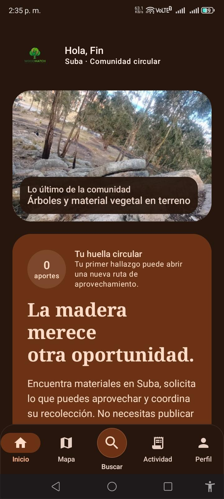
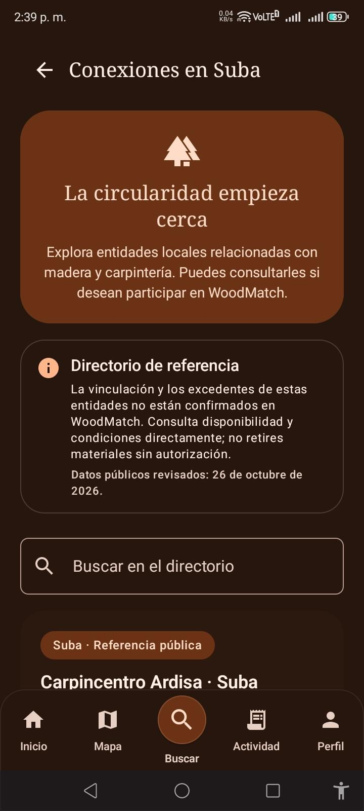

# Evidencias de pantallas y servicios TI — WoodMatch 2.3

**Ingeniería de Software II · ITIL 4**  
**Fecha del recorrido:** 30 de octubre de 2026  
**Responsables:** Juan Sebastian Fune Sanchez — desarrollo técnico; Yeison David Diaz Navarrete — gestión de pruebas y documentación.

> **Naturaleza de las evidencias.** Las 12 capturas seleccionadas corresponden al APK del piloto WoodMatch. Demuestran interfaces observadas, pero no sustituyen pruebas integrales, métricas de producción, SLA ni certificaciones de seguridad.

## Índice de evidencias

| ID | Pantalla | Servicios TI asociados |
|---|---|---|
| EV-01 | Exploración de invitado | ST-01, ST-03 |
| EV-02 | Inicio de comunidad | ST-03 |
| EV-03 | Catálogo comunitario | ST-03 |
| EV-04 | Mapa OpenStreetMap de Suba | ST-04 |
| EV-05 | Creación de reportes | ST-02 |
| EV-06 | Panel Mi actividad | ST-05, ST-07 |
| EV-07 | Álbum botánico | ST-09, ST-08 |
| EV-08 | Ayuda y participación | ST-12 |
| EV-09 | Centro de soporte Cookiestech | ST-12, ST-15 |
| EV-10 | Moderación de contenido | ST-13 |
| EV-11 | Privacidad y datos | ST-14 |
| EV-12 | Directorio Conexiones en Suba | ST-03 |

## Galería de capturas

### EV-01 — Exploración de invitado

**Servicio(s):** ST-01, ST-03  

**Descripción:** Muestra el acceso de invitado, la consulta del mapa y las rutas de registro o inicio de sesión.  
**Alcance de la captura:** No demuestra autenticación exitosa.

### EV-02 — Inicio de comunidad

**Servicio(s):** ST-03  

**Descripción:** Pantalla principal de WoodMatch después del acceso, con el resumen de comunidad circular.  
**Alcance de la captura:** El saludo de cuenta no aporta evidencia de una operación terminada.

### EV-03 — Catálogo comunitario

**Servicio(s):** ST-03  

**Descripción:** Muestra el listado de publicaciones y la búsqueda de madera y materiales.  
**Alcance de la captura:** Las publicaciones visibles son datos de prueba o de la comunidad y requieren moderación.

### EV-04 — Mapa OpenStreetMap de Suba

**Servicio(s):** ST-04  

**Descripción:** Presenta mapa interactivo de Suba, marcadores, controles de escala y atribución a OpenStreetMap.  
**Alcance de la captura:** No certifica disponibilidad sin conexión ni exactitud de cada marcador.

### EV-05 — Creación de reportes

**Servicio(s):** ST-02  

**Descripción:** Primer paso del formulario de hallazgo u oferta, con captura y selección de fotografía.  
**Alcance de la captura:** No acredita una publicación guardada hasta completar los tres pasos.

### EV-06 — Panel Mi actividad

**Servicio(s):** ST-05, ST-07  

**Descripción:** Vista de publicaciones, solicitudes y entregas del usuario.  
**Alcance de la captura:** Debe complementarse con casos verificables para demostrar un retiro completo.

### EV-07 — Álbum botánico

**Servicio(s):** ST-09, ST-08  

**Descripción:** Colección por cuenta con búsqueda, categorías y acceso al escáner de plantas.  
**Alcance de la captura:** El botón del escáner no prueba por sí mismo una identificación exitosa.

### EV-08 — Ayuda y participación

**Servicio(s):** ST-12  

**Descripción:** Formulario de reporte de casos y sección de seguimiento individual.  
**Alcance de la captura:** La pantalla vacía no prueba la resolución de un caso.

### EV-09 — Centro de soporte Cookiestech

**Servicio(s):** ST-12, ST-15  

**Descripción:** Resumen operativo de casos abiertos, prioridades, moderación y satisfacción.  
**Alcance de la captura:** Los indicadores mostrados corresponden al estado de la bandeja en la captura, no a datos agregados históricos.

### EV-10 — Moderación de contenido

**Servicio(s):** ST-13  

**Descripción:** Vista operativa del operador con búsqueda, filtros y un caso de moderación.  
**Alcance de la captura:** La imagen muestra un caso en estado resuelto; no sustituye evidencia del acto de moderar.

### EV-11 — Privacidad y datos

**Servicio(s):** ST-14  

**Descripción:** Muestra preferencias de diagnósticos y opción de exportación de datos personales.  
**Alcance de la captura:** No demuestra que la exportación se haya completado.

### EV-12 — Directorio Conexiones en Suba

**Servicio(s):** ST-03  

**Descripción:** Consulta de entidades locales de referencia vinculadas al aprovechamiento de madera.  
**Alcance de la captura:** El directorio no acredita alianza comercial o disponibilidad real.

## Cobertura por completar

| Servicio | Evidencia aún necesaria |
|---|---|
| ST-01 | Sesión iniciada y recuperación de credenciales |
| ST-05 | Solicitud, propuesta de fecha, aceptación y vencimiento validado |
| ST-06 | Emisión y validación de pase QR |
| ST-07 | PDF o JSON de una entrega con datos de prueba consistentes |
| ST-08 | Identificación botánica con resultado Pl@ntNet |
| ST-10 | Orientación Gemini con respuesta y límites |
| ST-11 | Bandeja de notificaciones y estado de entrega |
| ST-12 | Caso creado, priorizado, respondido, cerrado y, si aplica, reabierto |
| ST-15 | Captura del tablero KPI con fuentes y fórmulas validadas |

## Revisión y criterios de publicación

- Se recibieron 32 capturas y se publican 12 representativas, agrupadas por módulo.
- Se descartó una captura del historial de retiros donde la fecha y la cantidad mostradas no eran coherentes con los datos de la misma tarjeta. No usarla como comprobante de una transacción validada.
- Se excluyeron capturas del perfil que revelaban datos personales de la cuenta.
- Las capturas disponibles no reemplazan bitácoras, pruebas de dos dispositivos ni aprobaciones de CI Android, reglas o lint.
- Las imágenes se incorporaron como archivos JPEG optimizados para consulta y citación, conservando el aspecto real de las interfaces.

[Volver al catálogo de servicios TI](Catalogo-de-servicios-TI.md) · [Índice de documentación](Home.md)
