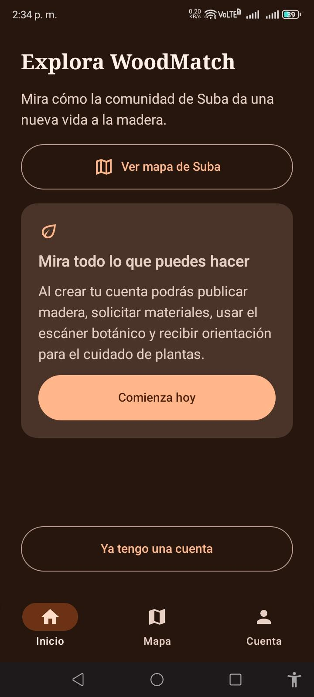
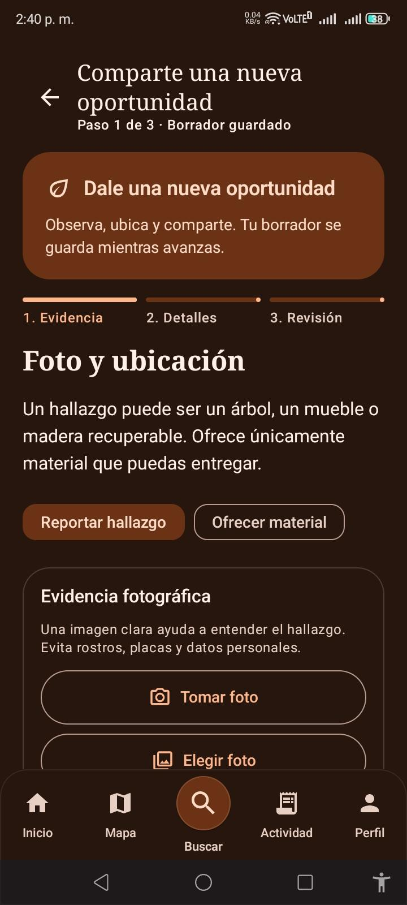
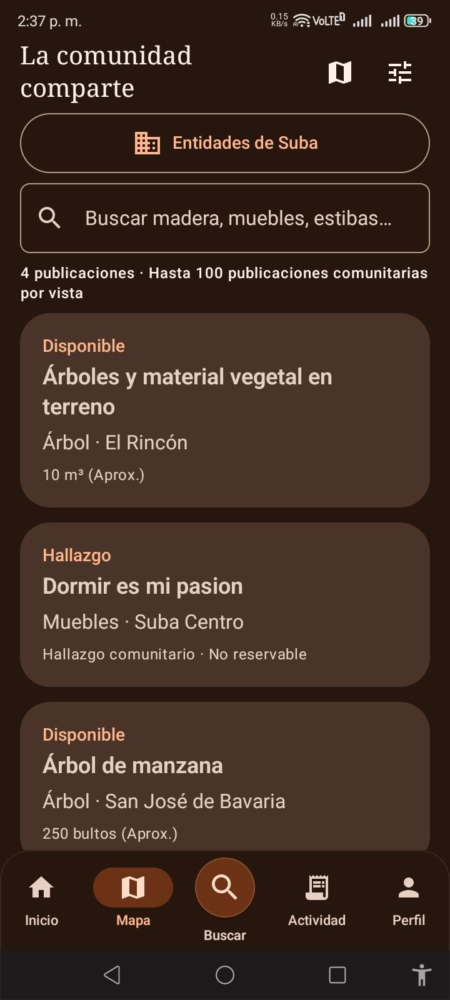
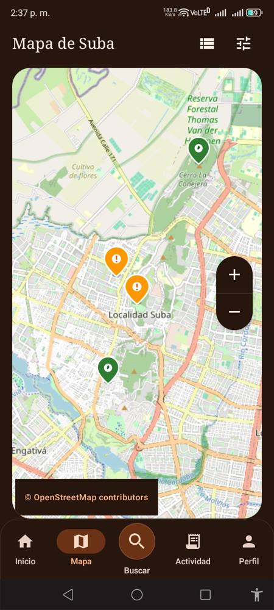
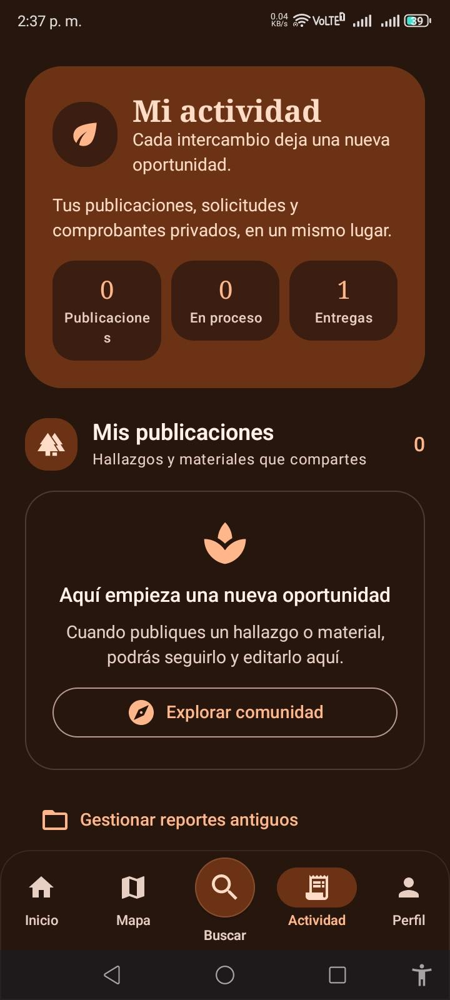
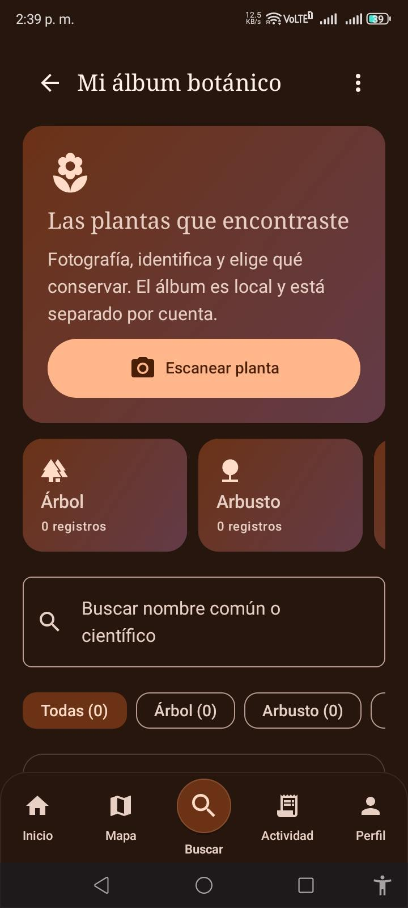
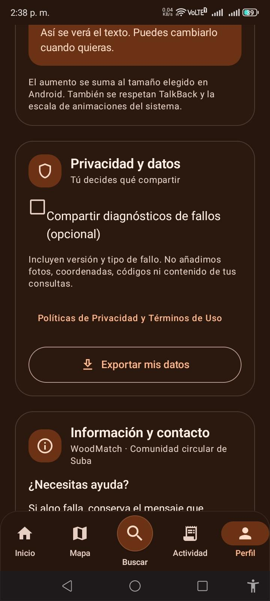
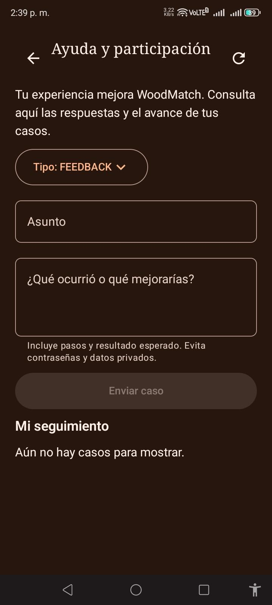
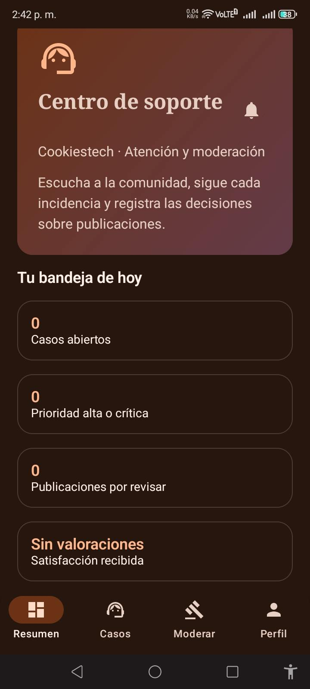
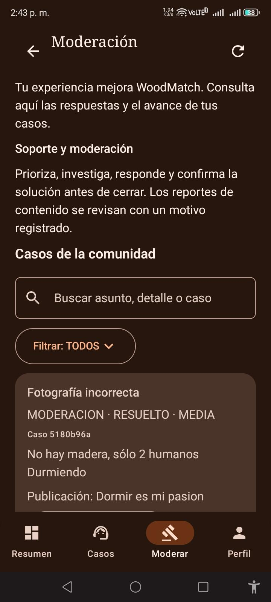

# Manual de usuario y gestión de servicios TI — WoodMatch 2.3

**Asignatura:** Ingeniería de Software II · Marco de trabajo ITIL 4  
**Entregable 5:** Manual de usuario para la gestión de servicios TI  
**Versión documental:** 2.0 · **Fecha de revisión:** 30 de octubre de 2026  
**Alcance:** piloto Android para la comunidad de Suba, Bogotá  
**Desarrollo y operación técnica:** Juan Sebastian Fune Sanchez  
**Gestión de pruebas y documentación:** Yeison David Diaz Navarrete

> **Estado y límites.** Este manual describe interfaces y operaciones observadas en el código y documentación de WoodMatch 2.3. Una pantalla implementada no equivale a una prueba integral en producción. Al cierre del PR #7, había pruebas locales de dominio/soporte y autenticación Edge, pero no evidencia completa del CI Android, reglas y lint de ese merge. Los objetivos de atención del catálogo ITIL 4 son **metas académicas propuestas, no SLA contractuales**. Los nombres de algunos botones pueden variar según la pantalla y la versión instalada.

## Índice

1. [Objetivo y documentos relacionados](#1-objetivo-y-documentos-relacionados)
2. [Requisitos, alcance y navegación](#2-requisitos-alcance-y-navegación)
3. [Roles y servicios disponibles](#3-roles-y-servicios-disponibles)
4. [Acceso, registro y recuperación](#4-acceso-registro-y-recuperación)
5. [Publicación de hallazgos y ofertas](#5-publicación-de-hallazgos-y-ofertas)
6. [Catálogo, mapa y directorio](#6-catálogo-mapa-y-directorio)
7. [Solicitudes, reservas y reprogramación](#7-solicitudes-reservas-y-reprogramación)
8. [Pase QR, entrega y comprobante](#8-pase-qr-entrega-y-comprobante)
9. [Mi actividad y notificaciones](#9-mi-actividad-y-notificaciones)
10. [Escáner y álbum botánico opcionales](#10-escáner-y-álbum-botánico-opcionales)
11. [Perfil, ajustes y datos personales](#11-perfil-ajustes-y-datos-personales)
12. [Registrar y seguir una incidencia](#12-registrar-y-seguir-una-incidencia)
13. [Operación de la mesa de ayuda Cookiestech](#13-operación-de-la-mesa-de-ayuda-cookiestech)
14. [Moderación de publicaciones](#14-moderación-de-publicaciones)
15. [Atención de fallos frecuentes](#15-atención-de-fallos-frecuentes)
16. [Protección de datos y uso responsable](#16-protección-de-datos-y-uso-responsable)
17. [Relación con ITIL 4 y medición](#17-relación-con-itil-4-y-medición)
18. [Responsabilidades y checklist de validación](#18-responsabilidades-y-checklist-de-validación)

## 1. Objetivo y documentos relacionados

Guiar al usuario final y al operador de soporte en el acceso a los servicios de WoodMatch y en el registro, seguimiento y atención de casos, estableciendo procedimientos reproducibles y controles de información acordes con las prácticas ITIL 4 de **mesa de servicio**, **gestión de incidentes**, **gestión de solicitudes de servicio** y **medición y reporte**.

Documentos de referencia:

- [Catálogo de servicios TI — 15 servicios](Catalogo-de-servicios-TI)
- [Evidencias visuales de pantallas](Evidencias-de-servicios)
- [Roles y ciclo de aprovechamiento](Roles-y-ciclo-de-aprovechamiento)
- [Arquitectura y servicios](Arquitectura-y-servicios)
- [Administración, feedback y moderación](Administracion-feedback-y-moderacion)
- [Operación, pruebas y lanzamiento](Operacion-pruebas-y-lanzamiento)

## 2. Requisitos, alcance y navegación

**Equipo:** teléfono Android con el APK del piloto WoodMatch instalado desde una fuente autorizada por el equipo, sin compartir credenciales ni archivos secretos. **Conexión:** necesaria para autenticación, publicaciones, solicitudes, soporte y proveedores externos. Algunas pantallas y datos locales pueden permanecer visibles sin red, pero no garantizan operaciones sin conexión. **Permisos:** cámara/galería y ubicación solo cuando el procedimiento los requiere; siempre se puede rechazar GPS y escoger un punto manualmente donde la interfaz lo permita.

El piloto de intercambio de material se limita a **Suba, Bogotá**. Consultar el mapa no autoriza ingreso a propiedades ni recolección de materiales.

| Navegación o módulo | Para qué sirve | Código de servicio |
|---|---|---|
| Inicio / Comunidad | Ver novedades y accesos a servicios | ST-03 |
| Crear | Registrar hallazgo u oferta con evidencia | ST-02 |
| Buscar / Catálogo | Consultar materiales y filtros | ST-03 |
| Mapa | Ver publicaciones geográficas y puntos aproximados | ST-04 |
| Mi actividad | Revisar solicitudes, reservas, pases e historial | ST-05, ST-06, ST-07 |
| Notificaciones | Leer cambios de solicitudes y soporte | ST-11 |
| Ayuda y participación | Enviar casos y consultar respuestas | ST-12 |
| Mi álbum botánico | Escáner opcional y colección local | ST-08, ST-09, ST-10 |
| Perfil / Ajustes | Preferencias, acceso y datos | ST-01, ST-14 |
| Centro de soporte | Bandeja restringida a Cookiestech | ST-12, ST-13 |

## 3. Roles y servicios disponibles

| Rol | Acciones principales | Restricciones |
|---|---|---|
| Visitante | Explorar la introducción y el mapa público | No publica, solicita ni accede a casos privados |
| Generador | Crear ofertas propias, recibir solicitudes, aceptar o rechazar y validar pases | No debe ofrecer materiales ajenos o sin autorización |
| Receptor | Explorar y solicitar material, emitir pase, confirmar recepción; reportar hallazgos cuando corresponda | No puede ofrecer material con un rol que no lo permita |
| Mixto | Combina acciones de generación y recepción | Sujeto a las validaciones de cada operación |
| Soporte Cookiestech | Atender casos, asignar prioridad, responder y moderar | Acceso restringido a la identidad autorizada; no administra todas las cuentas |
| Administrador | Funciones administrativas sujetas a autorización adicional | No se obtiene el privilegio escribiendo “ADMIN” en un perfil |

El selector de participación se presenta en el registro y también existen opciones de ajuste de perfil/rol en la versión actual; su guardado queda sujeto a las validaciones del servicio. **Nunca se registra una cuenta de soporte o administración desde el formulario público**.

## 4. Acceso, registro y recuperación

### 4.1 Explorar como visitante

1. Abrir WoodMatch y revisar **Explora WoodMatch**.
2. Seleccionar **Ver mapa de Suba** para observar información pública o **Comienza hoy** para registrarse.
3. Seleccionar **Ya tengo una cuenta** cuando se dispone de credenciales.

*Figura 1. Acceso inicial del piloto; evidencia de interfaz, no de sesión autenticada.*

### 4.2 Crear cuenta (ST-01)

1. Abrir **Crear cuenta**.
2. Elegir rol **Generador**, **Receptor** o **Mixto** según la actividad.
3. Completar nombre o razón social, correo, teléfono, sector de Suba y demás datos solicitados.
4. Establecer contraseña de al menos ocho caracteres, confirmarla y leer el aviso de privacidad.
5. Aceptar los consentimientos necesarios y pulsar **Registrarme**.
6. Verificar el resultado del registro e iniciar sesión con el correo y contraseña registrados.

No usar identidades ajenas, contraseñas compartidas ni datos de prueba que correspondan a terceros reales.

### 4.3 Iniciar sesión y recuperar acceso

1. Introducir correo y contraseña en **Iniciar sesión** y pulsar **Ingresar**.
2. Si olvidaste la contraseña, usa **¿Olvidaste tu contraseña?**, escribe tu correo y sigue el enlace recibido.
3. Consulta también la carpeta de correo no deseado. Si el error persiste, comprueba la conexión y reporta la incidencia sin publicar contraseñas ni enlaces privados.

El formulario de recuperación puede devolver respuestas neutrales para evitar revelar qué cuentas existen.

## 5. Publicación de hallazgos y ofertas

**Diferencia esencial:** el **hallazgo** comunica material observado y **no se reserva** como una oferta; la **oferta** expresa material que una persona autorizada puede entregar.

### Procedimiento (ST-02)

1. Desde **Inicio**, **Crear** o el botón de publicación, elige **Reportar hallazgo** u **Ofrecer material** conforme a tu rol.
2. **Paso 1 — Foto y ubicación:** adjunta una fotografía mediante **Tomar foto** o **Elegir foto**. Confirma un punto dentro de Suba, por GPS o de forma manual en el mapa.
3. **Paso 2 — Detalles:** completa título, tipo de material, condición física, cantidad aproximada en una oferta y descripción. Si no conoces la especie, no la inventes.
4. **Paso 3 — Revisión:** verifica foto, ubicación, datos y consentimiento de visibilidad; para ofertas confirma que tienes autorización para entregar el material.
5. Pulsa **Publicar**, mantén abierta la pantalla durante el envío y comprueba el resultado en **Mi actividad** o el catálogo.

**Opcional:** **Sugerir datos desde la evidencia** y **Orientación para este reporte** utilizan IA para proponer descripciones u orientación. El usuario debe revisar y decidir qué aplicar. **El escáner Pl@ntNet no es un requisito ni un paso obligatorio para crear una publicación.**

**Borradores:** al salir, la interfaz puede ofrecer **Guardar y salir**, **Descartar y cerrar** y **Continuar editando**. Una publicación reservada no puede editarse durante la reserva.

*Figura 2. Formulario de creación: la captura muestra el primer paso, no una publicación finalizada.*

## 6. Catálogo, mapa y directorio

### 6.1 Buscar materiales (ST-03)

1. Abrir **Buscar** o **Catálogo**.
2. Utilizar el campo de búsqueda y los filtros por condición, categoría, disponibilidad o sector según las opciones visibles.
3. Abrir una publicación para leer descripción, condición y estado.
4. Solicitar únicamente las **ofertas disponibles**. Un hallazgo no concede autorización de retiro.

*Figura 3. Lista y búsqueda comunitaria.*

### 6.2 Consultar mapa OpenStreetMap (ST-04)

1. Abrir **Mapa** desde la barra inferior o Inicio.
2. Ampliar, reducir o desplazar el mapa. Usar los filtros para explorar puntos.
3. Tocar un marcador para consultar la publicación relacionada.
4. Si la cartografía no carga, revisar conectividad; la caché puede conservar zonas visitadas, pero no garantiza el funcionamiento completo sin Internet.

No interpretar marcadores aproximados como autorización para ingresar a propiedad privada ni como coordenadas certificadas.

*Figura 4. Visualización de marcadores y atribución a OpenStreetMap.*

### 6.3 Conexiones en Suba

El directorio de entidades es una referencia pública. Buscar por nombre o actividad, consultar la fuente y utilizar los enlaces de contacto externos. **No implica convenio con WoodMatch, disponibilidad de materiales ni permiso para recogerlos**.

## 7. Solicitudes, reservas y reprogramación

### 7.1 Solicitar material (ST-05)

1. Como **Receptor** o **Mixto**, abrir una oferta disponible.
2. Pulsar **Solicitar** y completar uso previsto, fecha de recolección propuesta y mensaje/condiciones. Verificar que la cantidad o el material elegido correspondan a la oferta.
3. Enviar y consultar su estado en **Mi actividad → Solicitudes e historial**.
4. Esperar que el generador **acepte** o **rechace**. El sistema contempla una ventana de respuesta de **72 horas** para solicitudes pendientes. Si vence, la solicitud puede pasar a **Vencida**.

### 7.2 Responder como generador

1. Abrir **Mi actividad** y localizar la **solicitud recibida**.
2. Revisar uso previsto, fecha, detalles y disponibilidad real.
3. Seleccionar **Aceptar solicitud** para reservar material o **Rechazar**, indicando el **motivo obligatorio**.
4. Al aceptar, comprobar que el material aparece reservado y coordinar la entrega con la otra persona.

El estado de la solicitud y su plazo se muestran en el historial. **Las 72 horas no son el SLA de soporte técnico**, sino una regla de negocio de la solicitud de materiales.

### 7.3 Cambiar la fecha de una reserva

1. Abrir una **reserva aceptada**, antes de validar el pase de entrega.
2. Elegir **Proponer otra fecha** o **Solicitar cambio de fecha**.
3. Seleccionar una fecha vigente y escribir **motivo obligatorio**.
4. La otra parte recibe la propuesta y puede **Aceptar nueva fecha** o **No puedo asistir · cancelar reserva**, con justificación.
5. Si se acepta la nueva fecha, el pase anterior queda invalidado y debe emitirse otro al realizar el retiro. Si se rechaza por no poder asistir, se cancela la reserva.
6. Cuando exista una propuesta pendiente no es posible emitir cambios contradictorios; revisar la fecha límite de respuesta que muestra la pantalla.

El plazo de respuesta de la propuesta está limitado por las reglas del servidor (hasta 72 horas y, cuando corresponda, el límite de la reserva). Si no se responde, la lógica puede mantener el acuerdo anterior o cancelar, dependiendo de quién deba responder. **Consultar siempre el estado final en Mi actividad.**

### 7.4 Cancelar

Usar **Cancelar con motivo** en la solicitud activa, indicar por qué y confirmar. La contraparte recibe el cambio y la reserva se libera cuando la transición lo permite. No canceles para evitar una confirmación de entrega que sí ocurrió.

*Figura 5. Acceso al seguimiento de solicitudes y entregas; no reemplaza una prueba de reserva completada.*

## 8. Pase QR, entrega y comprobante

### 8.1 Generar y validar el pase (ST-06)

1. Con la reserva aceptada y la entrega coordinada, el **receptor** abre la solicitud y selecciona **Mostrar QR o código de entrega**.
2. La app presenta un QR y un código de ocho dígitos de duración limitada. La documentación técnica establece un pase de **10 minutos**; emitir uno nuevo invalida el anterior.
3. El **generador** abre la solicitud correspondiente y elige **Escanear QR** o **Validar código**.
4. Debe comprobar que el pase corresponda a esa solicitud, siga vigente y no haya sido utilizado. Si se rechaza, revisar motivo, vinculación y vencimiento antes de emitir uno nuevo.

No publicar ni compartir el código en redes sociales. La validación del pase **no sustituye la entrega física ni la confirmación de ambas personas**.

### 8.2 Completar entrega y obtener comprobante (ST-07)

1. Tras entregar/recibir efectivamente el material, cada participante selecciona **Confirmar que entregué** o **Confirmar que recibí**.
2. Esperar ambas confirmaciones; solo entonces se completa el retiro y se habilita el comprobante privado.
3. Abrir **Mi actividad → Solicitudes e historial → Comprobante de aprovechamiento**.
4. Seleccionar **Guardar o compartir comprobante** y elegir **PDF** o **JSON**.

El comprobante registra la operación y omite datos que no necesitan difundirse, pero **no es factura fiscal ni prueba legal de identidad, propiedad o certificación de especie**.

## 9. Mi actividad y notificaciones

**Mi actividad** reúne publicaciones propias, solicitudes recibidas/enviadas, cambios de estado, fechas, comprobantes y el historial de eventos. Usar los filtros **Todas**, **En proceso**, **Completadas**, **Canceladas**, **Rechazadas** y **Vencidas** cuando estén disponibles.

**Notificaciones (ST-11):**

1. Abrir el icono o bandeja **Notificaciones**.
2. Revisar mensajes de nuevas solicitudes, cambios de fecha, vencimientos y respuestas de soporte.
3. Tocar un aviso para abrir el caso o la solicitud relacionada y marcarlo como leído cuando proceda.
4. Si no aparece el aviso, pulsar **Actualizar avisos** y verificar conexión y permisos del dispositivo.

La presencia de una notificación en la bandeja no demuestra por sí sola entrega garantizada al sistema de notificaciones del teléfono.

## 10. Escáner y álbum botánico opcionales

Esta sección corresponde a funciones **complementarias**, independientes de los flujos centrales de publicación, reserva y retiro.

### 10.1 Escanear planta (ST-08)

1. Abrir **Mi álbum botánico → Escanear planta**.
2. Fotografiar una hoja, flor, fruto o corteza con luz suficiente, o seleccionar la imagen de la galería.
3. Elegir tipo de órgano (Automático, Hoja, Flor, Fruto o Corteza) si corresponde.
4. Seleccionar **Identificar con Pl@ntNet** y revisar las especies candidatas y su puntuación, sin asumir certeza.
5. Elegir etiquetas de clasificación; opcionalmente **Consultar cuidados (Gemini)**.
6. Pulsar **Guardar en mi colección** únicamente si deseas conservar ese registro.

Si no hay coincidencias, repetir la foto enfocando mejor el órgano. No usar el resultado para evaluar toxicidad, seguridad de consumo, permisos de tala, resistencia estructural ni tratamientos médicos.

### 10.2 Álbum botánico (ST-09)

Desde **Mi álbum botánico** se pueden buscar registros por nombre común o científico, filtrar por etiquetas y abrir detalles. Las imágenes y notas de cuidados pueden consultarse localmente después de guardarse.

**Respaldo:** menú de tres puntos → **Exportar colección con fotos**, guardar el ZIP en un lugar seguro. Para recuperar, elegir **Importar respaldo** y seleccionar el ZIP. La colección es **local y separada por cuenta**, no sincronización automática en la nube; respaldar antes de desinstalar la aplicación o cambiar de dispositivo.

*Figura 6. Vista del álbum. El botón de escanear no prueba una identificación exitosa.*

## 11. Perfil, ajustes y datos personales

1. En **Perfil** consultar la información de cuenta y acceder a **Editar mis datos** o **Ajustes**.
2. Cambiar datos permitidos y preferencias de accesibilidad: tema, tamaño del texto, compatibilidad con ajustes de Android.
3. En **Cambiar contraseña**, solicitar el flujo seguro de recuperación cuando sea necesario.
4. En **Privacidad y datos**, revisar consentimiento de diagnósticos opcionales.
5. Utilizar **Exportar mis datos (JSON)** cuando necesites guardar una copia y custodiarla de manera privada.
6. Para **Eliminar mi cuenta y datos definitivamente**, leer el alcance de la operación y confirmar solo cuando estés seguro. Es una operación destructiva; no emplearla como forma habitual de cerrar sesión.
7. **Cerrar sesión** cuando el dispositivo sea compartido.

No publicar capturas del perfil con correos, teléfonos o información de terceros.

*Figura 7. Pantalla de privacidad y exportación; no prueba que una exportación se haya completado.*

## 12. Registrar y seguir una incidencia

### 12.1 Diferenciar el tipo de caso (ST-12)

| Tipo en la app | Cuándo elegirlo | Ejemplo |
|---|---|---|
| **INCIDENCIA** | Algo no funciona o se interrumpe | No carga el mapa, falla una solicitud o aparece error de autenticación |
| **FEEDBACK** | Sugerencia o mejora | Mejorar los filtros del catálogo |
| **OPINION** | Comentario general de experiencia | Opinión sobre una pantalla |
| **SATISFACCION** | Valoración del servicio | Calificación de 1 a 5 estrellas |
| **MODERACION** | Reporte de publicación inapropiada desde su flujo de reporte | Imagen que no corresponde a madera |

No confundir la categoría general **Feedback** con una incidencia técnica. El reporte de moderación se origina desde las opciones de reporte de una publicación cuando la interfaz las presenta.

### 12.2 Enviar un caso

1. Abrir **Ayuda y participación** desde el acceso disponible en la aplicación.
2. Elegir el **Tipo** (para fallos, seleccionar **INCIDENCIA**).
3. Escribir **Asunto** y detallar qué ocurrió, pasos para reproducirlo, resultado esperado y mensaje de error, sin datos privados.
4. Para **SATISFACCION**, seleccionar la valoración requerida.
5. Pulsar **Enviar caso**. La aplicación asigna un identificador y estado inicial **NUEVO**.
6. Consultar **Mi seguimiento** y actualizar la pantalla para ver estado y respuesta.

El backend limita a **10 casos por usuario al día** para evitar abuso; si aparece el aviso correspondiente, consulta tus casos existentes en lugar de repetir envíos.

*Figura 8. Formulario de ayuda y participación.*

### 12.3 Consultar, resolver y reabrir

- El usuario puede seguir los estados **NUEVO**, **EN_REVISION**, **EN_PROGRESO**, **RESUELTO** y **CERRADO**.
- Cuando soporte responde, la respuesta y las novedades pueden aparecer en la bandeja de notificaciones.
- Si la solución no funciona y el caso está **RESUELTO** o **CERRADO**, abrirlo y seleccionar **Reabrir caso**, explicando el **motivo obligatorio**. El sistema cambia el caso a **EN_PROGRESO**.
- Evitar abrir casos duplicados por el mismo problema; usar el seguimiento o la reapertura cuando corresponda.

## 13. Operación de la mesa de ayuda Cookiestech

**Acceso exclusivo:** el operador autorizado utiliza la identidad de soporte configurada en Firebase; el backend verifica identidad y permisos. **No basta conocer una dirección de correo ni cambiar el rol local**. La cuenta se dedica a soporte y moderación y no permite las operaciones comunitarias de publicación/retiro.

### 13.1 Revisar la bandeja

1. Iniciar sesión con la cuenta de soporte autorizada.
2. Abrir **Centro de soporte → Atender casos** o **Bandeja de soporte**.
3. Revisar **casos abiertos**, **prioridad alta o crítica**, **publicaciones por revisar** y **satisfacción recibida**.
4. Usar buscador por asunto, detalle o ID y filtros de estado/prioridad.
5. Abrir el caso, revisar evidencia textual y clasificar su prioridad según impacto y urgencia.

*Figura 9. Resumen del operador; sus métricas corresponden a los casos cargados en la bandeja, no a un dashboard histórico validado.*

### 13.2 Gestionar caso de principio a fin

| Paso | Acción de Cookiestech | Evidencia esperada |
|---|---|---|
| 1. Registro | Abrir caso **NUEVO** y confirmar información | ID, tipo, fecha y asunto |
| 2. Clasificación | Seleccionar **BAJA**, **MEDIA**, **ALTA** o **CRITICA** | Prioridad guardada |
| 3. Investigación | Pasar a **EN_REVISION** o **EN_PROGRESO** | Estado e historial |
| 4. Comunicación | Registrar respuesta o pasos de solución | Respuesta visible para el usuario |
| 5. Resolución | Seleccionar **RESUELTO** al aplicar solución | Respuesta obligatoria antes de resolver |
| 6. Cierre | Seleccionar **CERRADO** cuando proceda | Estado final e historial |
| 7. Reapertura | Revisar justificación del usuario | Regreso a **EN_PROGRESO** si aplica |

Usar **Guardar seguimiento** después de cambiar estado, prioridad o respuesta. Si otro operador modificó el caso, el sistema puede advertir de un conflicto de revisión: actualizar la bandeja y volver a comprobar antes de guardar.

**Prioridades:** el backend asigna normalmente **MEDIA** a incidencias y moderaciones, y **BAJA** a otras categorías al crear el caso; Cookiestech puede ajustar a **ALTA** o **CRITICA**. Los valores reflejan prioridad de gestión, no garantía de atención en minutos u horas.

### 13.3 Diferenciar incidente, problema y cambio en ITIL

- **Incidente:** restablecer el servicio afectado y comunicar la solución al usuario.
- **Problema recurrente:** documentar varios incidentes relacionados, proponer análisis de causa raíz y transferir al desarrollador. **WoodMatch no cuenta todavía con un módulo independiente completo de gestión de problemas**.
- **Cambio técnico:** Juan Sebastian evalúa impacto y pruebas de una corrección; Yeison David registra evidencias y documentación. El despliegue/cierre técnico debe ser verificable por PR y pruebas. No afirmar que las pruebas CI pendientes ya fueron aprobadas.
- **Medición:** utilizar datos agregados de casos, prioridades, tiempos y satisfacción para proponer mejoras, distinguiendo datos del piloto de simulaciones académicas.

## 14. Moderación de publicaciones

1. Desde la publicación, el usuario utiliza la opción **Reportar** cuando se encuentre disponible y describe el contenido incorrecto.
2. Cookiestech abre **Revisar publicaciones reportadas** o **Moderación**.
3. Busca el caso, consulta publicación y fotografía asociadas y verifica las condiciones de la publicación.
4. Registra un **motivo obligatorio** y selecciona **Ocultar** o **Restaurar** cuando la transición esté autorizada.
5. Conserva ID, motivo, operación e historial para trazabilidad.

El sistema restringe la ocultación a ciertos estados de publicaciones (por ejemplo, hallazgo o disponible) y la restauración a contenidos previamente moderados. Una publicación reservada o ya recolectada requiere analizar primero el flujo de entrega. **Moderación no equivale a eliminación automática de cuenta ni permite bloquear usuarios desde la bandeja actual.**

*Figura 10. La imagen muestra una bandeja y un caso, no la ejecución probada de una decisión de moderación.*

## 15. Atención de fallos frecuentes

| Situación | Comprobación inicial del usuario | Cuándo registrar incidente |
|---|---|---|
| No inicia sesión | Verifica Internet, correo y contraseña; usa recuperación | Tras repetir con credenciales válidas sin éxito |
| Foto rechazada | Usa una imagen nueva enfocada; revisa permisos y tamaño | Cuando otras imágenes válidas también fallan |
| GPS no funciona | Concede permiso o elige ubicación manual en Suba | Si no permite seleccionar un punto válido |
| Mapa incompleto | Revisa conexión y vuelve a cargar; puede haber caché parcial | Si falla sistemáticamente con conexión estable |
| No aparece publicación | Revisa rol, estado, filtros y cuenta | Si una publicación guardada no figura tras actualizar |
| Solicitud vence | Consulta plazo e historial; busca otra oferta o nueva coordinación | Si el estado contradice la transición real |
| Pase QR inválido | Comprueba solicitud, plazo y uso; emite otro pase | Si un pase vigente y correcto falla repetidamente |
| Escáner no reconoce planta | Mejorar iluminación, enfoque y órgano; revisa cuotas | Si falla para múltiples imágenes aceptables |
| Álbum vacío tras cambiar móvil | Importa el ZIP previamente exportado | Si un respaldo íntegro no puede importarse |
| Notificación ausente | Actualiza bandeja y permisos de Android | Si cambios persistidos nunca se reflejan |
| Caso de soporte sin cambio | Actualiza bandeja, confirma conexión y estado | Si persiste error de sincronización |

**Plantilla breve para reportar un incidente:**  
**Servicio ST-__:** ____ · **Fecha/hora:** ____ · **Pantalla:** ____ · **Pasos realizados:** ____ · **Resultado esperado:** ____ · **Resultado observado:** ____ · **ID de caso/solicitud (si aplica):** ____ · **Versión de la app:** ____.

No enviar contraseñas, tokens, códigos de retiro vigentes, claves, fotografías de terceros ni ubicación exacta innecesaria.

## 16. Protección de datos y uso responsable

- Respetar permisos de foto, ubicación y privacidad; las publicaciones pueden compartir la evidencia y el punto confirmado con usuarios autorizados de la comunidad.
- La identificación Pl@ntNet, la orientación de Gemini y los datos aproximados **no certifican propiedad, especie, permisos, toxicidad, peso, seguridad ni aptitud estructural**.
- No retirar madera sin consentimiento de quien está legitimado para entregarla; coordinar físicamente antes de acudir.
- Mantener archivos de exportación JSON, ZIP de álbum, comprobantes y reportes ADB en espacios privados; no subirlos completos a Issues o Wiki públicos.
- Las capturas de este manual fueron seleccionadas para no exponer datos directos de perfiles. Ver su alcance limitado en [Evidencias de servicios](Evidencias-de-servicios).
- Para diagnóstico avanzado de cierres Android, el equipo técnico puede usar ADB en un dispositivo autorizado y sanear cualquier registro antes de compartirlo.
- No introducir claves privadas de Firebase, Supabase o proveedores externos en APK, capturas, repositorios ni chats.

## 17. Relación con ITIL 4 y medición

| Práctica ITIL 4 | Procedimiento en WoodMatch | Evidencia operativa | Observación |
|---|---|---|---|
| **Mesa de servicio (Service Desk)** | Ayuda y participación; bandeja Cookiestech | ID, respuesta, caso | Implementado en código |
| **Gestión de incidentes** | Clasificación, seguimiento, resolución y reapertura | Estado, prioridad, historial | Operación y pruebas extremo a extremo por validar |
| **Gestión de solicitudes de servicio** | Registro, consultas, retiros; ayuda | Solicitudes y trazabilidad | No confundir reserva de materiales con SLA de TI |
| **Gestión de problemas** | Escalamiento de fallos repetidos a desarrollo | Registro de causa raíz propuesto | Proceso manual propuesto, no módulo separado completo |
| **Seguridad de la información** | Autenticación, roles, consentimientos, moderación | Controles y casos | Verificar reglas/CI antes de declarar certificación |
| **Medición y reporte** | Resumen Cookiestech y tablero KPI académico | Conteos, tiempos, satisfacción | Distinguir métricas reales de simuladas |
| **Mejora continua** | Revisión de incidentes y propuestas de cambio | Acciones correctivas y PR | Gobernanza propuesta para equipo de dos personas |

**KPIs recomendados para el servicio ST-12:**

| Indicador | Cálculo | Precaución |
|---|---|---|
| Tasa de resolución | Casos resueltos / casos recibidos en el período × 100 | Definir corte temporal y exclusiones |
| Tiempo de primera respuesta | Primera respuesta de soporte − creación del caso | La hora puede requerir tratamiento de eventos/historial |
| Casos reabiertos | Casos reabiertos / casos resueltos × 100 | Identificar reabiertos, no duplicar |
| Satisfacción | Promedio de calificaciones 1 a 5 | No extrapolar si hay pocas respuestas |
| Casos por prioridad | Cantidad agrupada por BAJA/MEDIA/ALTA/CRITICA | No confundir con incidencia real |
| Cumplimiento de objetivos internos | Casos respondidos dentro de meta / evaluables × 100 | Metas académicas, no SLA firmados |

Véase el [catálogo de servicios TI](Catalogo-de-servicios-TI) para fichas ST-01 a ST-15 y objetivos internos propuestos.

## 18. Responsabilidades y checklist de validación

### 18.1 Responsables reales del proyecto

| Actividad | Juan Sebastian Fune Sanchez | Yeison David Diaz Navarrete |
|---|---|---|
| Desarrollo Android y backend | Ejecuta y responde por cambios técnicos | Consulta y verifica resultados |
| Corrección de errores y control de versiones | Responsable técnico | Evidencia pruebas de aceptación |
| Pruebas funcionales | Apoyo técnico y correcciones | Ejecuta, registra y responde por evidencias |
| Manual, evidencias y catálogo ITIL 4 | Revisa consistencia con el sistema | Redacta, consolida y mantiene documentación |
| Análisis de indicadores | Revisa viabilidad de datos | Verifica presentación, fórmulas y trazabilidad |

El **usuario de soporte Cookiestech** es una identidad operativa de la aplicación y no una tercera persona del equipo ni un sustituto de la matriz RACI.

### 18.2 Lista de comprobación para la entrega académica

- [ ] La versión del APK utilizada coincide con la versión citada en el manual.
- [ ] Se demuestra registro e ingreso con datos de prueba, sin divulgar información privada.
- [ ] Se demuestra una publicación válida con foto y punto de Suba.
- [ ] Se demuestra consulta en catálogo y mapa OSM.
- [ ] Se prueba una solicitud con respuesta, reserva, cambios de fecha y vencimiento cuando corresponda.
- [ ] Se demuestra emisión de pase, validación, doble confirmación y comprobante PDF/JSON.
- [ ] Se prueba creación de incidencia, clasificación, respuesta, resolución y reapertura.
- [ ] Se comprueba la restricción de acceso al operador Cookiestech.
- [ ] Se demuestra moderación con motivo e historial en datos de prueba.
- [ ] Se comprueba notificación en bandeja.
- [ ] Se prueba escáner y respaldo ZIP **solo como funcionalidades complementarias**.
- [ ] Las capturas están saneadas y vinculadas a servicios ST.
- [ ] Las cifras del tablero están diferenciadas entre datos medidos y simulados.
- [ ] Las comprobaciones pendientes de CI Android, reglas y lint están registradas; no se afirma que pasaron sin evidencia.

---

**Mantenimiento del manual.** Actualizar al cambiar pantallas, transiciones de solicitudes, permisos o flujos de soporte. Antes de publicar una nueva versión, contrastar el manual con el APK real y con las evidencias verificadas. Los cambios documentales deben revisarse mediante Pull Request y no deben introducir credenciales ni datos personales.

**Enlaces:** [Catálogo TI](Catalogo-de-servicios-TI) · [Evidencias](Evidencias-de-servicios) · [Índice de Wiki](Home)
