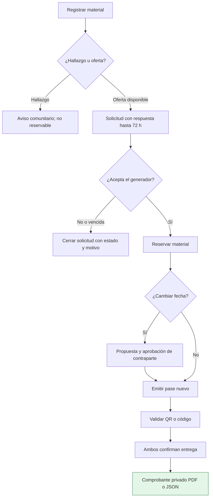

# Roles y ciclo de aprovechamiento — WoodMatch 2.3

Vigente para la documentación del piloto revisada el 30 de octubre de 2026. Véase [Manual de usuario y gestión de servicios TI](Manual-de-usuario.md).

## Roles de aplicación

| Rol | Puede hacer | Condición importante |
|---|---|---|
| **Visitante** | Explorar bienvenida y mapa público | No publica ni solicita sin autenticarse |
| **Generador** | Ofrecer material, atender solicitudes, validar pase y confirmar entrega | Debe poder entregar el material legítimamente |
| **Receptor** | Buscar y solicitar materiales, generar pase y confirmar recepción | Puede registrar hallazgos según el formulario; no convierte el hallazgo en una oferta sin autorización |
| **Mixto** | Funciones de generador y receptor | Requiere permisos y validaciones de cada operación |
| **Soporte Cookiestech** | Bandeja de casos, seguimiento, respuesta y moderación | Acceso exclusivo verificado en servidor; no es administrador global |
| **Administrador** | Administración general solo cuando exista autorización firmada y reglas efectivas | No basta seleccionar o escribir `ADMIN` en un perfil |

## Esquema visual de la entrega

## Flujo principal de aprovechamiento

1. La persona registra un **hallazgo** o **oferta** con fotografía y ubicación confirmada en Suba.
2. Una **oferta disponible** puede recibir una solicitud de un receptor o usuario mixto; el hallazgo **no es reservable**.
3. El generador revisa la solicitud, **acepta** (reserva atómica) o **rechaza** indicando el motivo.
4. Una solicitud **PENDIENTE** tiene un plazo de respuesta de **72 horas**; el sistema puede registrar su vencimiento y notificar a los participantes.
5. Con la reserva aceptada se puede **proponer una nueva fecha** antes de validar la entrega, indicando motivo obligatorio. La contraparte la acepta o decide no asistir/cancelar con explicación.
6. La propuesta pendiente tiene un plazo de respuesta y está condicionada por el vencimiento de la reserva. El efecto del vencimiento depende de quién esperaba respuesta; consultar la transición final en **Mi actividad**.
7. El receptor emite pase **QR/código temporal de ocho dígitos**. Según la documentación técnica, caduca en **10 minutos** y emitir otro invalida el anterior.
8. El generador valida el pase correspondiente; la validación **no equivale** a confirmar la entrega física.
9. **Ambas personas** confirman entrega/recepción. Solo entonces queda el comprobante exportable en PDF o JSON, y el material deja de figurar como disponible.
10. Cancelaciones, rechazos y vencimientos se registran en el historial, y las reservas se liberan conforme a las reglas de negocio.

Una publicación reservada no puede editarse. La reprogramación puede invalidar pases previos y exigir emitir otro. No confiar en ubicaciones aproximadas para ingresar a inmuebles ni recolectar materiales sin permiso.

## Soporte y servicios complementarios

- **Ayuda y participación:** registrar incidencias, feedback, opiniones y satisfacción; recibir respuestas y reabrir casos cerrados/resueltos con motivo.
- **Moderación:** reportar contenidos desde el flujo de publicación; Cookiestech gestiona el caso con motivo, trazabilidad y validación de estados.
- **Álbum y escáner botánico:** funcionalidades **opcionales** basadas en Pl@ntNet y asistencia orientativa; no son un paso obligatorio para publicar u obtener materiales.

[Volver al catálogo de servicios TI](Catalogo-de-servicios-TI.md) · [Evidencias](Evidencias-de-servicios.md) · [Inicio](Home.md)
