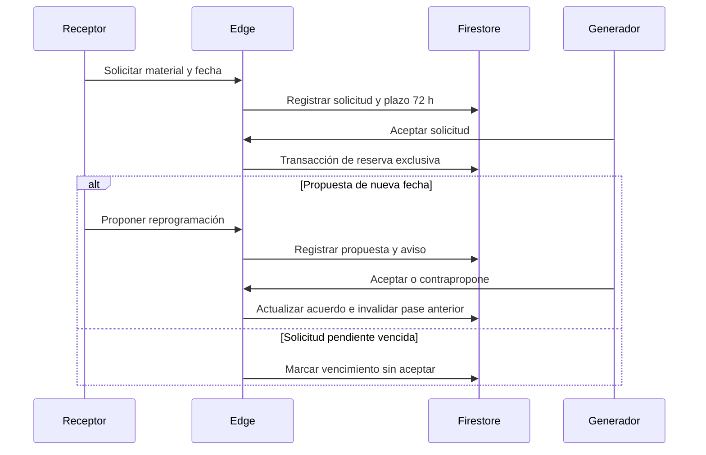
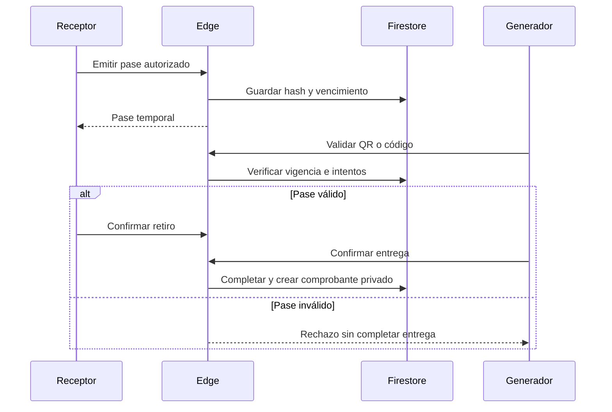
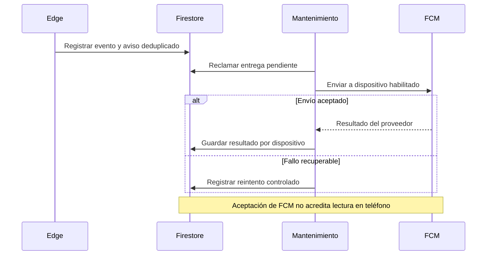
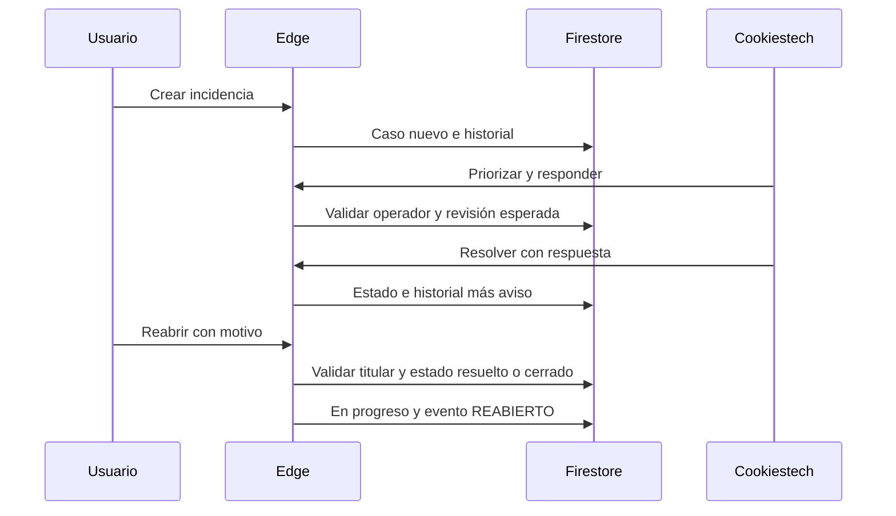

# Secuencias de servicio

Secuencias conceptuales contrastadas con `domain.mjs`, `lifecycle.mjs`, `support.mjs` y mantenimiento. Describen implementación, no pruebas físicas realizadas. [Calidad](Control-de-calidad-y-evidencias.md).

## Reserva y reprogramación

## QR y doble confirmación

## Notificaciones

## Soporte y reapertura

